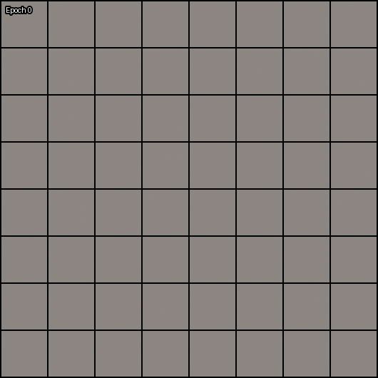

# DCGAN for Anime Face Generation

[](https://colab.research.google.com/github/YOUR_USERNAME/dcgan-anime-faces/blob/main/notebooks/dcgan_anime_faces.ipynb)


A clean PyTorch implementation of a Deep Convolutional GAN (DCGAN) that learns to generate 64×64 anime faces from scratch. The whole pipeline (data download, training, evaluation, and artifact export) runs in a single Google Colab notebook.

## Results

### Training progress

The same 64 noise vectors are rendered after every epoch, from the untrained generator (Epoch 0) to the final epoch.

<p align="center">
  
</p>

### Generated samples

<p align="center">
  
</p>

### Training curves

<p align="center">
  
</p>

> GAN losses do not measure image quality on their own, so the results are evaluated visually. No quantitative metric such as FID is reported.

## Quick Start

**Google Colab (recommended)**

1. Click the **Open in Colab** badge above.
2. Select a GPU: **Runtime → Change runtime type → GPU**.
3. Run **Runtime → Run all**. The dataset is downloaded automatically.

**Local**

```bash
git clone https://github.com/YOUR_USERNAME/dcgan-anime-faces.git
cd dcgan-anime-faces
pip install -r requirements.txt
jupyter notebook notebooks/dcgan_anime_faces.ipynb
```

The last notebook cell uses `google.colab` to download the figures, so skip it when running locally.

## Dataset

[Anime Face Dataset](https://www.kaggle.com/datasets/splcher/animefacedataset) on Kaggle: 63,565 anime face images of varying sizes (mostly square, roughly 32×32 to 135×135 pixels). It is downloaded at runtime with `kagglehub` and is not stored in this repository. Please see the dataset page for its source and terms of use.

**Preprocessing:** resize and center-crop to 64×64, random horizontal flip, normalize to [-1, 1].

## Method

The architecture follows [Radford et al. (2016)](https://arxiv.org/abs/1511.06434).

| Component | Description |
| --- | --- |
| Generator | Latent vector (100) → 4 transposed-conv blocks (512 → 256 → 128 → 64 channels, BatchNorm, ReLU) → 3×64×64 image, `Tanh` output |
| Discriminator | 4 strided-conv blocks (64 → 128 → 256 → 512 channels, BatchNorm, LeakyReLU 0.2) → single logit |
| Loss | `BCEWithLogitsLoss` with one-sided label smoothing (real label = 0.9) |
| Initialization | Conv and BatchNorm weights drawn from N(0, 0.02) |

### Training configuration

| Setting | Value |
| --- | --- |
| Epochs | 30 |
| Batch size | 128 |
| Optimizer | Adam (lr = 2e-4, β = (0.5, 0.999)) |
| Latent dimension | 100 |
| Image size | 64×64 RGB |
| Seed | 42 |

All values are defined in the `Config` dataclass at the top of the notebook.

## Repository Structure

```
dcgan-anime-faces/
├── notebooks/
│   └── dcgan_anime_faces.ipynb   # full pipeline
├── assets/                       # figures shown in this README
├── requirements.txt
├── LICENSE
└── README.md
```

## Limitations

- Training is short (30 epochs), so some faces show artifacts and limited variety.
- The smallest images in the dataset are upsampled to 64×64, which makes them blurrier.
- Results can vary between runs because GPU operations are not fully deterministic.

## References

- A. Radford, L. Metz, S. Chintala. *Unsupervised Representation Learning with Deep Convolutional Generative Adversarial Networks.* ICLR 2016. [arXiv:1511.06434](https://arxiv.org/abs/1511.06434)

## License

Released under the [MIT License](LICENSE). The dataset is third-party and subject to its own terms.
